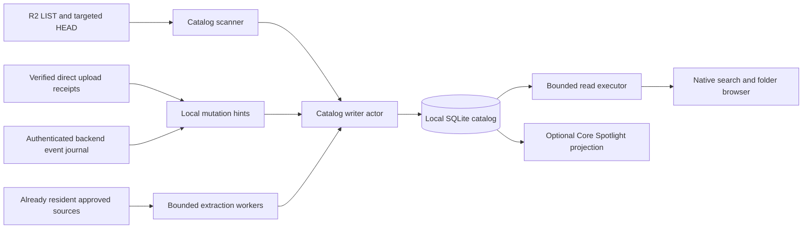

# Persistent metadata catalog and instant local search

Implementation proposal · researched November 3, 2026. The initial metadata catalog, native search, verified-upload outbox, worker invalidation feed and automatic reconciliation are now implemented; see [current behavior](LOCAL_SEARCH.md) and [qualification results](LOCAL_SEARCH_VERIFICATION.md). See [automatic-update semantics](AUTOMATIC_INDEX_UPDATES.md) for the delivered design; other later phases below remain a proposal.

## 1. Recommendation

Build a persistent, device-local SQLite catalog of the configured R2 prefix, then run all interactive filename, path and metadata searches against that catalog. Populate it using paginated object listings, update it from verified app operations, and reconcile it in the background. Searching must never enumerate the mounted drive, wait for R2, or download file contents.

Deliver this in two independent steps:

1. **Fast search and app browsing:** a native search window, local folder browser and durable metadata catalog. This provides useful results even with Finder disconnected or the network unavailable.
2. **Fast Finder metadata operations:** instrument and then extend the rclone/NFS backend so directory enumeration can benefit from persistent metadata without hiding pending writes or compromising recovery. Merely adding a Swift database cannot accelerate Finder's existing NFS requests.

Add content extraction and system Spotlight integration after these steps. Vector search, OCR and a hosted metadata service are optional later features; none is necessary for instant filename search.

The initial guarantee should be: **search the last known inventory immediately, with explicit coverage and freshness information**. Do not promise instant discovery of previously unseen remote files or instant opening of uncached content.

## 2. What the current code actually does

These observations describe the inspected working tree, including existing uncommitted direct-upload work. They are not claims about a shipped version.

| Owning source | Observed behavior | Design consequence |
| --- | --- | --- |
| `Sources/CloudDrive/Drive.swift`, `start()` | Launches patched `rclone serve nfs`; `--dir-cache-time 30s`, `--poll-interval 0`; Finder opens the mounted directory | Remote listings can recur after a short cache lifetime; there is no configured remote change polling |
| `Sources/CloudDrive/DashboardView.swift` | Dashboard, upload card, storage status and Open in Finder | No app search UI or local inventory browser currently exists |
| `Sources/CloudDrive/Connection.swift` | Dedicated R2 prefix, destination identity; Keychain-backed credentials | Partition catalog by destination fingerprint; never store credentials in catalog rows |
| `Sources/CloudDrive/UploadQueueStore.swift` | Existing SQLite3 binding, private file checks, exclusive lock, DELETE journal, FULL synchronous, 64 MiB bound | Reuse defensive patterns, **not** its database, capacity limit or recovery lifecycle |
| `Sources/CloudDrive/DirectUploadEngine.swift` | Persists verified completion; recovered completion can also be recognized during cancellation/restart | Publish indexing hints from every verified completion path, not only the happy path |
| `Sources/CloudDrive/MultipartRemote.swift` | Native signed R2 transport, HEAD and multipart operations, bounded response handling | Extract reusable signing/transport carefully; add a separate read-only listing interface |
| `Sources/CloudDrive/Runtime.swift`, `ControlClient` | Authenticated bounded worker control requests | Extend this protocol for metadata events only with ownership, versioning and response bounds |
| `Sources/CloudDrive/LocalStorage.swift` | Local allocation accounting avoids scanning mounted content | Preserve this rule for indexing and enrichment |
| `vendor/patches/README.md` | Pinned rclone 1.75.2/go-nfs base; allocation patches | Any backend extension needs reproducible patches and fixture qualification against this pinned base |
| `docs/ARCHITECTURE.md`, `docs/LIMITATIONS.md` | One active writer, safe eject/drain/recovery, direct uploads separated from Finder writes | A catalog is an observer; it must not bypass these gates or introduce another mount/writer |

The 30-second cache setting is a plausible source of repeat listing latency, not a measured diagnosis of every reported slowdown. Capture timings before claiming causality. Search, folder enumeration, thumbnails, file opening and transfer throughput are different workloads.

## 3. Research findings and design choices

### Helumi: supported observations and uncertainty

[Helumi's public site](https://www.helumi.app/) advertises Finder integration, partial-file streaming and a global “find any file” shortcut, Control–Option–O. The public page reviewed does **not** document its catalog schema, indexing engine, persistence model or reconciliation protocol. A local metadata catalog is a reasonable way to build a similar experience, but it is not a verified description of Helumi's implementation. Streaming playback also does not establish how search works.

### Alternatives

| Approach | Appropriate use | Decision |
| --- | --- | --- |
| SQLite B-tree indexes + FTS5 | Embedded metadata filtering, name/path search, offline persistence | Recommended foundation; no separate search daemon |
| Longer rclone directory caching | Reduce repeated network listing for visited folders | Measure as a limited improvement; does not provide global persistent search |
| Core Spotlight | Publish app items to system search | Optional projection; retain app catalog as source of search behavior |
| Apple File Provider | Native placeholder lifecycle and system-managed enumeration | Separate architecture project; not a prerequisite for the NFS app's search |
| Recursive traversal through Finder/NFS | Ad hoc discovery | Reject for interactive search and indexing; creates mount dependencies and unpredictable metadata work |
| Full cloud content download | Complete text/media analysis | Explicit opt-in only; expensive and defeats metadata-only operation |
| Lucene/Tantivy/custom mmap engine | Specialized workloads beyond embedded SQL performance | Defer until reproducible measurements justify another engine |
| Hosted search/remote manifest | Cross-device shared discovery | Optional later service; conflicts with a simple no-service default |

[rclone documents](https://rclone.org/commands/rclone_mount/#vfs-directory-cache) its directory cache as in-memory metadata, separate from payload caching. VFS changes update/invalidate it; outside changes depend on expiry or supported backend polling. Increasing its lifetime trades freshness for fewer requests. Qualify options with `serve nfs` on the pinned build rather than assuming every FUSE mount option applies.

[SQLite FTS5](https://www.sqlite.org/fts5.html) supports token/prefix and trigram substring search. Trigrams require separate handling for queries shorter than three Unicode characters. Check the linked runtime's capabilities before adopting them. [SQLite WAL](https://www.sqlite.org/wal.html) permits readers alongside a writer but requires checkpoint management and local storage. The documentation also reports a WAL-reset fix in 3.51.3, with backports to 3.44.6 and 3.50.7: verify the shipped runtime has the fix before enabling the proposed topology, or ship a vetted SQLite build. A successful development-machine test is not an OS compatibility guarantee.

[S3 ListObjectsV2](https://docs.aws.amazon.com/AmazonS3/latest/API/API_ListObjectsV2.html) supplies keys and basic object properties in pages of up to 1,000; continuation tokens are opaque. LIST does not supply the full HEAD/custom metadata set. Check each requested option against [R2's compatibility table](https://developers.cloudflare.com/r2/api/s3/api/). [R2 strongly consistent listings](https://developers.cloudflare.com/r2/reference/consistency/) describe each request's view; do not infer that a multi-request scan is one atomic snapshot.

[Core Spotlight](https://developer.apple.com/documentation/corespotlight) supports indexing items from an app. It does not make our NFS volume a fully indexed Finder filesystem. Apple's [File Provider working set documentation](https://developer.apple.com/documentation/FileProvider/defining-your-file-provider-s-content) describes system Spotlight indexing of enumerated working-set items, offering a separate long-term integration route.

## 4. System architecture and invariants



Required invariants:

1. Search runs with zero network requests and zero mount traversal, even during a scan.
2. Only confirmed publication becomes `remote_confirmed`. Dirty Finder files and queued direct jobs remain distinct overlays.
3. A failed, cancelled, stale or partial scan never proves deletion.
4. A late network response from an old destination/session cannot modify the active destination.
5. Search uncertainty cannot alter upload durability, cache ownership or worker recovery behavior.
6. Catalog loss may require reindexing; it must never lose accepted upload work. User-authored tags/notes need separate durable treatment.
7. Index and preview eviction never remove dirty payloads, source originals, upload records or worker/session records.
8. Credentials, signed URLs, control tokens and raw search queries do not enter diagnostics or exported fixtures.

### Component boundaries

`CatalogCoordinator` owns lifecycle, destination epoch, pause/resume and scan state. `CatalogStore` serializes writes on a dedicated executor. A small `CatalogReadPool` uses separate read-only handles; synchronous SQLite calls run off the main actor. A Swift actor alone is not a guarantee that blocking C calls stay off the UI executor.

`ObjectInventoryRemote` is read-only: `listPage(prefix, token, limit)` and `head(key)`. It uses existing credential-session authorization without introducing unsolicited Keychain prompts. It can run while Finder is disconnected because LIST/HEAD do not create another writer. It must still share rate limits and pause when upload pressure requires it.

`SearchService` parses a constrained query language and returns immutable pages. `CatalogProjection` merges remote facts with pending overlays and private annotations. Enrichment workers never directly edit SQL tables.

## 5. Metadata contract

| Category | Save | Provenance and invalidation |
| --- | --- | --- |
| Identity | Destination fingerprint, exact UTF-8 key bytes, internal item ID, exact parent key, display name, entry kind | `(destination, exact key)` is remote identity; internal IDs survive an app-observed rename only when proven |
| Basic remote facts | Logical size, LastModified, opaque ETag, storage class when returned | LIST/HEAD observation with timestamp; ETag is a validator, not a universal content hash |
| Search fields | Normalized name/path, extension, inferred kind, tokenization version | Derived locally; normalization must never change remote identity |
| Rich object metadata | Content-Type, known original mtime, explicitly supported custom metadata, checksum algorithm/value | Targeted HEAD or verified upload metadata; label unknown rather than invent values |
| Media/document facets | Width, height, duration, codec, sample rate, page count, author/title if available | Local extraction, source validator and extractor version |
| Local intent | Upload job reference, dirty/pending status, intended size and destination | Existing queue or worker journal; not a claim of remote existence |
| Availability | Remote-only, partial-cache, verified-resident, unknown | Live authoritative cache observation plus sample time; never infer from logical size |
| Discovery | First seen, last observed, scan generation, missing candidate, last confirmation | Catalog observations, not original creation dates |
| Private organization | Tags, notes, favorites, recent use, saved searches | Durable local user data; not reconstructed by LIST |
| Extracted content | Text snippets, optional full text, OCR/transcript provenance | Opt-in scope, byte quota, content validator and explicit stale state |

Do not equate S3 LastModified with original file creation or original filesystem mtime. Preserve those values during upload when explicitly supported, but do not silently change existing remote formats. Import existing rclone metadata only after confirming how the pinned S3 backend encodes it.

Keep exact keys as binary identity to avoid Swift canonical-equivalence or collation merging of distinct remote names. Derived case/diacritic folding is for search only. Explicitly test NFC/NFD pairs, case-only differences, emoji, newlines, literal `%`, `+`, XML characters, very long paths and repeated `/` segments.

S3 keys may not map safely onto local filesystem paths. Treat leading `/`, `..`, empty segments and file/directory collisions as catalogable but potentially unrepresentable in Finder. Preserve them in search with an explanation; do not silently sanitize and open a different object. Use one percent-decoding pass when LIST requests `encoding-type=url`; never decode arbitrary keys a second time.

## 6. Storage design

Use separate private locations under the existing compatibility root:

```text
Application Support/BucketDrive/
  Catalog/<destination-fingerprint>/catalog.sqlite
  Library/<destination-fingerprint>/annotations.sqlite
  Previews/<destination-fingerprint>/...
```

`Catalog` is rebuildable inventory and derived search data. `Library` contains durable annotations/saved searches plus their backups. Thumbnails/text caches have independent quotas. Do not put these inside the mount, payload cache or user-selected multipart records directory. WAL databases should stay on a local supported volume, not SMB/NFS.

Use owner-only directories/files and validate symlink/hardlink/ownership replacement as the existing store does. Include WAL/SHM sidecars in protection, accounting and backup logic. Preserve established identifiers and fingerprints; do not rename the compatibility root.

### Proposed core schema

This is a starting migration for inventory, not the complete annotation/event/enrichment schema. One database belongs to one verified destination. Times below are Unix milliseconds; all mutations use bound parameters.

```sql
PRAGMA foreign_keys = ON;

CREATE TABLE catalog_meta (
  singleton INTEGER PRIMARY KEY CHECK(singleton = 1),
  destination_fingerprint TEXT NOT NULL,
  schema_version INTEGER NOT NULL,
  normalization_version INTEGER NOT NULL,
  published_scan_id INTEGER,
  catalog_revision INTEGER NOT NULL DEFAULT 0
);

CREATE TABLE objects (
  id INTEGER PRIMARY KEY,
  key_bytes BLOB NOT NULL UNIQUE,
  parent_bytes BLOB NOT NULL,
  name TEXT NOT NULL,
  name_search TEXT NOT NULL COLLATE BINARY,
  path_search TEXT NOT NULL,
  extension TEXT NOT NULL DEFAULT '',
  kind INTEGER NOT NULL CHECK(kind IN (0,1,2)),
  size_bytes INTEGER CHECK(size_bytes >= 0),
  remote_modified_ms INTEGER,
  etag TEXT,
  observed_ms INTEGER NOT NULL,
  remote_revision INTEGER NOT NULL DEFAULT 0,
  deleted_ms INTEGER
);
-- kind: 0=object, 1=explicit directory marker, 2=synthetic directory.
CREATE INDEX objects_name ON objects(name_search, id) WHERE deleted_ms IS NULL;
CREATE INDEX objects_parent ON objects(parent_bytes, name_search, id) WHERE deleted_ms IS NULL;
CREATE INDEX objects_type_time ON objects(extension, remote_modified_ms DESC, id) WHERE deleted_ms IS NULL;
CREATE INDEX objects_size ON objects(size_bytes, id) WHERE deleted_ms IS NULL;

CREATE TABLE scans (
  id INTEGER PRIMARY KEY,
  scope_bytes BLOB NOT NULL,
  state TEXT NOT NULL CHECK(state IN ('running','paused','failed','completed','abandoned')),
  started_ms INTEGER NOT NULL,
  finished_ms INTEGER,
  start_revision INTEGER NOT NULL,
  continuation_token TEXT,
  page_number INTEGER NOT NULL DEFAULT 0,
  observed_count INTEGER NOT NULL DEFAULT 0
);
CREATE TABLE scan_seen (
  scan_id INTEGER NOT NULL REFERENCES scans(id) ON DELETE CASCADE,
  key_bytes BLOB NOT NULL,
  PRIMARY KEY(scan_id, key_bytes)
) WITHOUT ROWID;

CREATE TABLE pending_mutations (
  event_id TEXT PRIMARY KEY,
  key_bytes BLOB NOT NULL,
  operation TEXT NOT NULL,
  local_revision INTEGER NOT NULL,
  origin TEXT NOT NULL,
  state TEXT NOT NULL,
  observed_ms INTEGER NOT NULL
);
CREATE INDEX pending_key ON pending_mutations(key_bytes, local_revision);

CREATE VIRTUAL TABLE object_terms USING fts5(
  name_search, path_search,
  tokenize='unicode61', prefix='2 3 4'
);
-- Optional capability-gated addition, measured before enabling:
CREATE VIRTUAL TABLE object_substrings USING fts5(
  name_search, tokenize='trigram'
);
```

FTS rowid equals `objects.id`. Insert/update/delete both ordinary and FTS rows in the **same transaction** through one mutation adapter. This proposal deliberately uses contentful FTS tables for simpler correctness; benchmark their extra disk cost before considering external-content tables. A tombstoned object must be removed from FTS or always filtered out by a join. Migration tests must prove consistency after crash and rollback.

Additional migrations need `missing_candidates`, keyed enrichment jobs/results, directory coverage, backend event checkpoints and durable retry/outbox records. Annotation storage needs stable local item UUIDs, exact last-known key bytes, binding provenance, tag memberships, notes and saved query ASTs. Integer catalog row IDs are not durable cross-rebuild annotation IDs.

### Runtime policy

Start with a single serialized writer and two read handles, short transactions, bounded busy timeout, foreign keys on, trusted schema off and extension loading disabled. Use WAL only after runtime qualification; centralize checkpoint ownership. NORMAL synchronous is an option for rebuildable inventory, with documented possible recent-observation loss on power failure; annotations should use FULL. Never change the upload store's FULL/DELETE durability to match the catalog.

Checkpoints and FTS merges need time budgets and scheduling away from interactive load. Do not hold read transactions across UI lifetime. Interrupt cancelled queries using a leased connection/query generation so cancellation cannot hit a later query that reused the same handle. Bound WAL growth and detect disk pressure before starting a large scan. If capability/version qualification fails, provide indexed B-tree prefix search and explain unavailable substring support rather than scanning all rows silently.

## 7. Initial inventory and reconciliation

### Read-only bootstrap

1. Capture destination fingerprint, coordinator epoch, scan ID and current mutation revision.
2. Restore the last valid catalog immediately; show its last observation time.
3. Issue ListObjectsV2 for the exact configured prefix plus `/`, without delimiter for recursive inventory. If the application supports a root marker object at the bare prefix, handle it explicitly; never accidentally include a neighboring prefix such as `clouddrive-other/`.
4. Request up to 1,000 items per page with supported URL encoding. Validate bucket, scope, status, response size, XML structure, numeric bounds, token progress and cancellation. Use a streaming/bounded parser, disable external entity resolution, and do not reuse the multipart-specific XML parser unchanged.
5. In one short transaction: upsert valid observations, record `scan_seen`, update progress and save the next opaque token. Reject an old epoch before committing. Page replay is idempotent; no token advances before its page commit.
6. Publish newly observed items progressively. Keep existing rows until missing-item reconciliation proves absence. Distinguish partial initial coverage from completed historical coverage plus an active refresh.
7. Infer synthetic ancestors from exact path segments, in the same transaction or a bounded follow-up queue. Empty directory markers remain distinct from inferred directories; reconcile conflicting file/folder names explicitly.
8. A final non-truncated page marks enumeration complete. It does not certify a global atomic snapshot or immediately delete every unseen row.

Do not issue HEAD for every listed item. Basic search works from LIST data; run HEAD only for selected details, missing candidates or prioritized enrichment. Begin with one listing chain and two HEAD requests in flight. Partition scans only on disjoint prefix scopes with separate coverage records; a continuation chain itself is sequential.

Tokens may become invalid or old after long suspension. Resume opportunistically; on rejection abandon the generation and begin a fresh scan. Never concatenate old and new incomplete generations and call the union complete. A resumed historical scan cannot by itself justify sweeping rows created while it was paused.

### Safely detect changes and deletions

Maintain a monotonic local revision. Compare response request-start revision with per-key changes. A LIST response that started before a verified local upload must not overwrite the newer observation. Skip/requeue conflicted keys and HEAD them after local operations settle.

Only a successfully completed scope scan may create missing candidates for previously observed keys in that scope. Exclude keys affected by pending operations, event gaps or newer local mutations. For a conservative v1, perform targeted HEAD on candidates, then tombstone only confirmed 404/NoSuchKey outcomes that still match the candidate revision. Auth failures, 403, timeouts, throttling and malformed replies are **unknown**, never absence. Recheck after a grace interval or subsequent scan when remote writers are possible. Large disappearance sets require a circuit breaker and another scan before publishing mass tombstones; never delete cloud objects as part of indexing.

HEAD confirmation still cannot make concurrent outside writes atomic. Its result is an observation; a later event/scan resurrects a recreated key. Attach validator/timestamp to results and revalidate before consequential future operations.

Reconcile directory aggregates from published child changes; remove a synthetic folder only when its known children and pending overlays are gone and coverage is adequate. Folder size/count aggregates can be asynchronous and approximate; indicate partial totals instead of blocking every page on a whole-tree recount.

### Scheduling and economics

Suggested starting policy, to be tuned with measurements:

- Restore/search immediately at launch; trigger a background scan on first setup and a debounced refresh when connectivity returns.
- Refresh the visible folder on demand, no more frequently than a short configurable freshness window.
- Run full prefix reconciliation on an adaptive schedule, initially daily for small catalogs; avoid a fixed frequent full scan for million-object prefixes.
- Prioritize visible-folder refresh, verified-operation reconciliation, missing confirmation, then inventory and enrichment. Back off with jitter on throttling/network failures.
- Pause optional enrichment on battery/Low Power Mode, transfer pressure or low disk space. Let users pause scanning and clear derived caches separately from annotations.

For N objects, full scan request count is approximately `ceil(N/1000)` LISTs, possibly more when pages are short. One million objects is about 1,000 LISTs per pass; every five minutes would be about 288,000 LISTs/day. These are arithmetic estimates, not provider cost quotes. Measure actual calls and check current pricing before setting defaults. Do not replace this with one million HEADs.

## 8. Immediate updates from app activity

### Direct uploads

Emit a catalog hint only after the upload engine persists a verified receipt. Handle normal completion, recovered completion, completion discovered during cancel, and restart reconciliation. Include destination fingerprint, exact key, size, validator, receipt ID and observation time; omit source bookmarks and credentials.

Cross-database writes cannot be assumed atomic. Prefer a durable upload-store outbox written with receipt persistence, replayed idempotently into the catalog and acknowledged afterward. This changes the recovery store and requires its own migration/fault tests. A simpler first slice can replay existing verified receipts at launch and rely on remote scans, but clearing completed history before catalog acknowledgement must not lose the only immediate update signal. Catalog failure must not turn a successful upload into a failed upload or remove its receipt.

Queued/uploading items may appear as a pending overlay with intended size. They must not appear as verified cloud objects or provide fake offline-open availability.

### Finder mutations

Swift does not observe all remote publications merely by polling transfer counters. Propose a backend journal with a persistent session identity and monotonic sequence, exposing bounded authenticated pages through worker control:

```text
metadata/events(afterSequence, limit)
  -> protocolVersion, sessionID, firstRetainedSequence,
     events[], nextSequence, hasMore, gap
```

Events distinguish local create/write/close, remote publication, rename steps, delete success and uncertainty. Include key, operation ID, sequence and available validator. Persist publication events independently of payload eviction. Catalogue commits event application plus its consumed sequence transactionally; acknowledgements and journal pruning happen later. A crash after cloud publication but before journal persistence remains possible: remote reconciliation is mandatory.

Authenticate the owned worker exactly as current recovery does. Capability-negotiate old recovered workers; without journal support use scans, not restart/kill to force an upgrade. Gaps, retention overflow, session replacement and unavailable journals invalidate only the affected metadata coverage and schedule reconciliation. Never infer a published upload merely because a queue entry disappeared.

An app-observed rename can preserve annotation identity when its operation proves the mapping. Remote copy+delete is not atomic: represent its intermediate/uncertain state. Unrelated delete/create or equal ETags are not proof of rename. On unprovable rename, retain orphaned annotations for user recovery rather than attaching them to another file.

## 9. Search behavior and execution

Provide a native search panel from the menu and a configurable shortcut. The exact default should be checked for collisions; avoid copying Helumi's shortcut automatically. Offer filename/path, kind, extension, size, modified date, tags and availability filters. Example syntax:

```text
vocals
"final mix" ext:wav
kind:video size:>1GB modified:2026-01-01..
tag:client in:"Projects/Album A"
```

Define semantics: whitespace means AND; quoted phrases preserve words; `in:` is a descendant scope with segment boundaries; `modified:` uses remote LastModified unless an explicit original-date field is selected; GB is decimal and GiB binary. Unknown original dates/availability must not pass filters as known values. Unknown operators should yield a useful parse error or literal-search option.

Pipeline:

1. Debounce about 40–75 ms, but measure total keystroke-to-render latency including debounce.
2. Parse into a small typed AST with limits on bytes, tokens and nesting. Bind SQL parameters. Compile literal text safely for FTS syntax too: SQL binding alone does not prevent FTS operators changing semantics.
3. Select candidate sources by query shape: exact name B-tree, name prefix range, token prefix FTS, optional trigram substring, then metadata predicates. One/two-character queries use indexed prefix semantics; explain that arbitrary short substrings are unavailable.
4. Normalize search text consistently with a versioned policy; preserve exact key bytes. Use binary half-open ranges for normalized prefixes with a tested successor implementation. Do not rely on SQLite's default LIKE for full Unicode case folding.
5. Return 50 results initially; use stable keyset pagination and a catalog revision in the cursor. Define restart behavior when a refresh changes ordering; do not hold a long-lived read transaction or use deep OFFSET.
6. Apply an explicit deterministic ranking: exact filename, filename prefix, filename tokens, substring, path-only matches; then modest recency/favorite boosts and exact-key tie break. Keep filename relevance stronger than incidental path matches.
7. Check request/destination generation before UI delivery; discard late results. Treat cancellation and bounded timeout as normal states.

Substring strategy needs separate performance/recall tests. Use trigram MATCH on safely quoted normalized literal terms of length at least three, intersect candidates and verify literal substring semantics. Do not assume LIKE with ESCAPE will use the trigram index; the documented optimization has constraints. If fuzzy matching is added, run edit-distance scoring on a bounded, meaningfully generated candidate set and label approximate results. A candidate cap means approximate recall, which should be measured rather than called exhaustive.

For narrow size/type/date filters combined with common text, compare FTS-first versus filter-first plans. Record `EXPLAIN QUERY PLAN`, page reads and cancellation behavior at realistic scale. Do not implement a global `LIKE '%query%'` scan followed by `LIMIT 50`; LIMIT does not bound work before the matches are found. Exact total counts are optional background work, not part of first paint.

### UI contract

Show name, containing folder, kind, logical size, relevant date and availability. Add a compact state such as “Indexing: 42,000 files discovered”, “Last checked 20 minutes ago”, or “Offline · searching saved inventory”. A completed scan does not mean every file has content indexed; display enrichment coverage independently.

Support keyboard navigation, VoiceOver, escape-to-close and open/reveal actions. Search itself must work with Finder disconnected. Opening/revealing can offer the existing safe connection flow; it must not silently start another writer or bypass pending direct-upload gates. Uncached files cannot open offline merely because their metadata is searchable. Validate exact key-to-mount mapping before passing URLs to NSWorkspace.

## 10. Improving Finder latency

Measure this separately from local search. First collect cold/warm timings for a small folder, a 10,000-entry folder, a deep tree, repeated revisit after expiry, reconnect, and outside mutation. Separate app, worker, NFS and network time; count LIST, HEAD, GET and downloaded bytes.

### Short-term experiment

Compare the current 30-second directory cache with 5- and 15-minute values on isolated fixtures. Use explicit bounded refresh of selected paths where supported. Keep freshness visible and avoid recursive full-tree prewarming. Promote a setting only when p95 enumeration improves without failing mutation visibility/recovery tests. These values are experiment inputs, not a recommendation to silently change user behavior.

### Persistent backend metadata path

If profiling shows directory discovery dominates, implement a separate persistent metadata provider at the VFS/backend boundary. Do not insert blocking Swift/UI callbacks into NFS request handling. Prefer a backend-owned metadata store with a versioned snapshot/delta export to Swift, or an immutable published snapshot imported by the backend; avoid two independently writable catalogs becoming competing authorities.

Before implementing, trace pinned rclone VFS list/stat/writeback/rename behavior and define exactly where cached observations can satisfy requests. The provider needs directory coverage and freshness, dirty overlay precedence, stable node/handle identities, bounded memory, remote validator checks and conservative fallback. Search DB row IDs must not become NFS file handles.

Start read-only: persist clean remote directory observations, restore lazily, and fall back to ordinary backend listing when coverage is absent or stale. Never negative-cache a partial directory as complete. A newer local create must shadow an older persisted listing; a pending delete must not reappear from an old snapshot. Reject/truncate no filenames silently when persisting. Detect multi-page folder inconsistency and event gaps.

This extension may reduce list/stat latency but cannot remove network latency for uncached file bytes, repair dead-worker waits, or make Finder's Spotlight search equivalent to app search. Keep existing allocation patches, process authentication and dirty-data recovery unchanged in meaning, and qualify them again after integration.

## 11. Enrichment and saving important metadata

Implement three explicit tiers:

1. **Inventory:** names, paths, logical sizes and remote timestamps from LIST. On by default.
2. **Details:** bounded targeted HEAD metadata and extraction from approved already-resident local sources. Prioritize visible/recent files. Never open a remote mount path just to discover whether it is cached.
3. **Content intelligence:** opt-in text/PDF extraction, OCR, transcription or embeddings, with download, CPU, disk and privacy budgets. No silent whole-drive hydration.

At upload time, the original resident file is the cheapest enrichment source. Perform extraction outside the critical upload path with source identity rechecks; bind results to the verified final remote validator. If extraction sees a changing source, discard its result. Do not retain source bookmarks in the rebuildable catalog.

Use ImageIO/AVFoundation/PDFKit/UTType as appropriate after API/OS verification. Some parsers read widely or seek to file ends; a small range request does not guarantee successful extraction. Run untrusted document processing with resource limits and a killable helper when needed. Define per-format byte/time/page limits and retry suppression for repeatedly failing files.

Key derived results by `(destination, exact key, validator, extractor_version)`. Invalidate immediately when known remote content changes. Do not display old media facets/text as current after replacement; retain stale results only with a clear status. ETags alone do not prove universal content equality or deduplication.

Keep private annotations durable and exportable. A rebuild preserves them and rebinds only where identity is supported; retain unresolved annotations. Initially tags/notes are app-local, not Finder tags or cross-Mac data. Remote sidecars/manifests require a versioned object format, collision/merge rules, reserved namespace, migration and explicit opt-in; do not write them during a metadata-only scan. Do not bulk rewrite objects merely to attach metadata.

## 12. Optional system and cross-device extensions

Core Spotlight can publish a bounded set of catalog items with stable identifiers and activation routed back into the app. Track projection revision and deletion tombstones, support rebuild after system index loss, and make privacy/exclusion settings explicit. Verify appearance and activation on supported macOS releases; do not claim Finder-volume search parity without testing it.

File Provider migration should have its own ADR covering identifiers, working-set/change anchors, hydration, eviction, conflicts, pending writes and transition from NFS. Reuse the catalog abstractions, not assumptions that NFS handles and File Provider IDs are interchangeable.

[R2 event notifications](https://developers.cloudflare.com/r2/buckets/event-notifications/) can feed a Queue and be consumed through a Worker or HTTP pull. This introduces infrastructure and credentials beyond ordinary object access. If later adopted, treat events as hints, tolerate duplicates/reordering/gaps, persist delivery checkpoints and reconcile periodically. A shared work queue is not a broadcast feed to several Macs: use a durable per-destination change log and independent device cursors. Do not enable resources as part of the local implementation.

## 13. Resource budgets and performance acceptance

These are proposed gates, **not measured results**. Establish a baseline on the minimum supported Apple Silicon Mac and record OS, SQLite runtime, memory, SSD free space, dataset, warm/cold cache and concurrent scan state.

| Metric | Initial acceptance target |
| --- | --- |
| First 50 warm results, 100k objects | p95 under 100 ms end-to-end, including debounce |
| First 50 warm results, 1m objects | p95 under 150 ms end-to-end; revise design if broad queries miss this |
| Cold restore plus first results, 1m objects | p95 under 750 ms on reference hardware |
| Interactive cancellation | Obsolete query stops within 100 ms under fixture load |
| Main thread | No SQLite, directory traversal, network or extraction blocking work |
| Search network/payload activity | Exactly zero requests/bytes, including offline tests |
| Verified local publication visibility | Within 1 second when catalog healthy; durable replay after failure |
| Indexer memory | Initial ceiling 128 MiB RSS increase, excluding OS-shared pages; measure separately from app/worker |
| Background I/O | Bounded page transactions, capped concurrency; searchable during bulk scan |
| Disk | Account DB + FTS + WAL + scan staging + annotations + previews separately |

Budget with measurements rather than asserting metadata is free. As a planning hypothesis, 1–4 KiB/object for rows/indexes/search implies roughly 1–4 GiB at one million objects, before previews/text and rebuild headroom. Benchmark real path lengths and directory counts; trigram expansion and long shared paths can dominate. Set configurable quotas and reserve space for WAL, staging and atomic rebuild; stop discovery gracefully when the reserve is threatened. Never evict upload data to satisfy catalog budgets.

## 14. File-level implementation sequence

| Milestone | Proposed files/change | Exit condition |
| --- | --- | --- |
| M0: baseline and ADR | `docs/INDEXING_BENCHMARK_BASELINE.md`, synthetic fixtures, `scripts/qualify-catalog.py` | Separate search/list/open/thumbnail latency; no real credentials required; accept semantics and budgets |
| M1: persistent inventory | `CatalogModels.swift`, `CatalogStore.swift`, `CatalogMigrations.swift`, `CatalogCoordinator.swift`, `ObjectInventoryRemote.swift`, shared `S3RequestSigner.swift` | Paginated restart-safe LIST, destination isolation, complete/partial states, offline restore, safe missing confirmation |
| M2: local query engine | `SearchQuery.swift`, `SearchService.swift`, `CatalogReadPool.swift` | Prefix/token/filtered search; gated substring path; cancellation and scale gates; no network access in query layer |
| M3: native discovery UI | `SearchView.swift`, `SearchController.swift`, `CatalogBrowserView.swift`; integrate `App.swift`, `Drive.swift`, menu/dashboard | Keyboard-accessible search/browse, visible freshness, safe open/reveal through existing lifecycle |
| M4: publication freshness | Upload receipt outbox/replay; `CatalogEventConsumer.swift`; versioned backend event patch | Crash-safe verified updates, old-worker fallback, gap recovery and pending overlays |
| M5: Finder acceleration | Profile-driven backend metadata provider patch and snapshot protocol | Measurable native enumeration gain; dirty overlays, handles, allocation and recovery remain correct |
| M6: durable organization/details | `AnnotationStore.swift`, `MetadataEnricher.swift`, bounded helper, preview policy | Rebuild preserves notes/tags; validator invalidation; no unintended hydration |
| M7: optional projections | `SpotlightProjection.swift`; separate File Provider/service ADRs | Tested system activation, privacy removal and documented limits |

M1–M3 are the smallest useful release slice. M4 makes freshness much better for app writes; do not market external-writer freshness as instantaneous. M5 is necessary to claim improved Finder metadata performance, and should not block app-local search.

After adding Swift sources, regenerate the native project with `python3 scripts/generate-xcode-project.py` and inspect its diff. Verify both SwiftPM and Xcode compilation; runtime SQLite feature availability and release linking must match. Preserve existing uncommitted work and do not regenerate/reformat unrelated files during guide-only preparation.

## 15. Verification matrix

| Test area | Required cases |
| --- | --- |
| Listing/parser | Empty prefix, 1/999/1000/1001 items, short truncated pages, repeated/missing tokens, duplicate keys, malformed XML, oversized responses, unsupported encoding, 403/404/429/5xx |
| Scan durability | Kill before/after page commit and final-page commit; repeat pages; expired tokens; pause across outside mutations; resume without false completeness |
| Concurrency | Upload after LIST begins; upload during missing confirmation; delete/recreate same key; stale epoch on connection change; late callback after shutdown |
| Missing/deletion | Partial/failed scans, permission loss, large missing set circuit breaker, targeted HEAD auth failure, confirmed absence and recreation |
| Identity | Unicode canonical variants, case differences, `%`/`+`/spaces, XML characters/newlines, path collisions and unrepresentable mount keys |
| Search | Literal FTS syntax, SQL metacharacters, short queries, phrases, all filters, no-match worst case, common terms, filter-first/FTS-first plans, stable pagination |
| Storage | Full disk mid-transaction, corrupt DB, migration interruption, missing WAL, owner/symlink replacement, read-only volume, WAL budget exhaustion |
| Annotation recovery | Catalog rebuild, unproven rename, deletion/recreation, orphan retention, export/import; no accidental key rebinding |
| Event/outbox | Duplicate delivery, replay, gaps, old worker, ACK crash, journal overflow, receipt cleared before ACK, remote-success/local-journal crash |
| Offline behavior | No Keychain prompt, no socket activity, no mount traversal; metadata results remain available, uncached open explained |
| Enrichment | Corrupt/malicious/huge file, timeouts, changing source, parser crash, validator mismatch, extraction quota, no mount hydration |
| Finder qualification | Readdir/stat latency, stable handles, pending creates/deletes/renames, crash recovery, clean allocation and dirty-cache retention |
| Performance | 10k/100k/1m objects, deep and wide trees, long names, mixed scripts, 100 repeated queries, cold/warm, scan overlap, power/thermal conditions |

Use deterministic synthetic datasets and a loopback S3 inventory fixture with request counters. Search tests should fail on *any* attempted network call. Add seeded property-based/fuzz tests for key encoding and query parsing, plus crash injection for page/outbox boundaries. Record dataset generator seed and hashes for reproducibility. Benchmarks should report distributions and worst cases rather than a single best run.

Appropriate implementation checks include focused new Swift tests, existing upload/recovery tests after integration, SwiftPM/Xcode builds, reproducible patched backend build, and native fixture qualification for M5. Actual R2 compatibility qualification should use a separately authorized disposable prefix; no live bucket scan, write, resource creation or deployment is part of preparing this guide.

## 16. Decisions to preserve and unresolved questions

Recommended defaults: local SQLite inventory, no content downloads, app-native search first, separate durable annotations, no hosted service, conservative deletion reconciliation, existing writer/recovery gates retained. Keep the existing macOS 14 baseline unless a separate product decision changes it.

Resolve during M0:

- Is the first complaint slow global discovery, slow reopening folders, slow thumbnails, or slow file reads? Record each independently.
- What are representative object count, path depth and file mix? Use synthetic approximations before accessing personal inventory.
- Should tags/notes stay device-local, or is cross-Mac organization a required later feature?
- Is full-text indexing worth explicit download/storage costs, and for which formats/scopes?
- Can supported macOS runtimes supply the required fixed SQLite/FTS capabilities, or should the app bundle SQLite?
- Does profiling justify extending rclone, or does app-local browsing plus a measured cache adjustment meet the immediate need?

The design can proceed through M1–M3 using the recommended defaults without requiring these optional extensions. Completion means demonstrating local query latency, accurate coverage states and safe failure behavior—not simply creating an FTS table.
